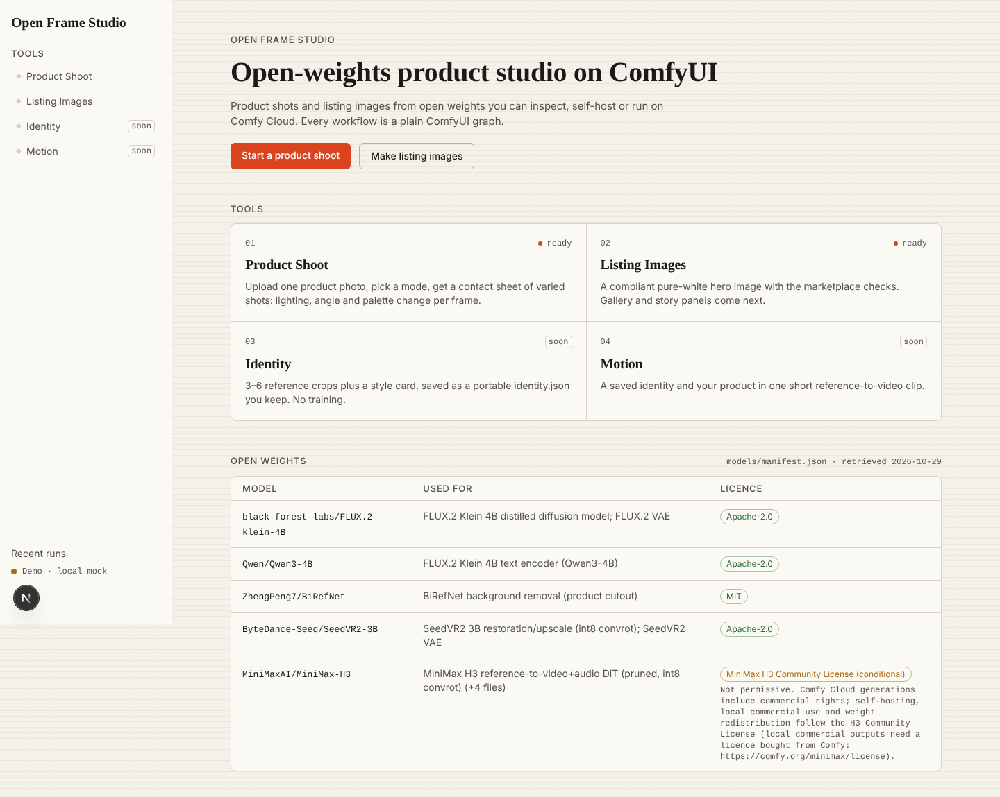
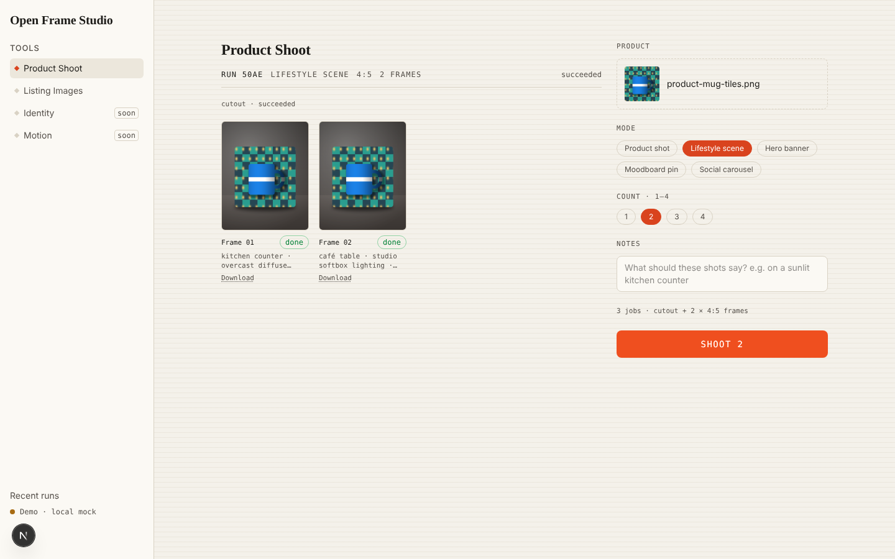
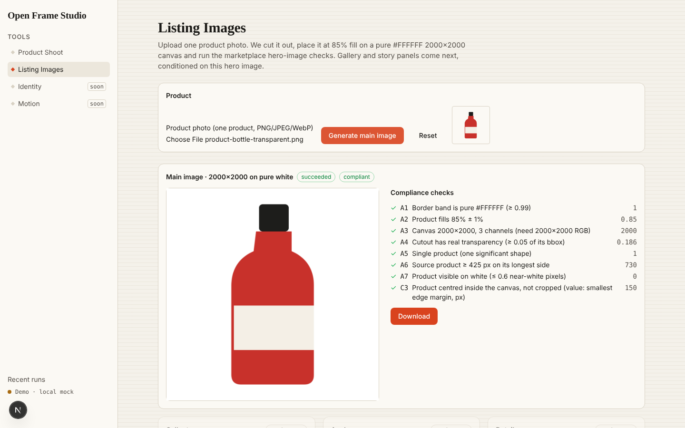

# Open Frame Studio

Open Frame Studio is an open-weights creative studio built on the ComfyUI inference engine, made for Comfy's Open Source Higgsfield challenge. It takes the best ideas from hosted AI photo studios and rebuilds them as open, inspectable ComfyUI graphs, with its own names, flows and design. It runs through the Comfy API, either on Comfy Cloud or on your own GPU.

You upload 5–20 photos of a person once and get an **identity**: a curated reference set (the best 3–6 crops after photo checks) plus a style card, saved as a portable `identity.json` bundle you download and keep. You can then put that identity and your product into a **product shoot** (ten shoot modes, from clean packshots to on-model and ad sets), build **listing images** (a compliant white-background hero image plus gallery and story panels anchored on it), and turn the result into a short **motion** clip. Every model in the pipeline is open weights (FLUX.2 Klein 4B, BiRefNet, SeedVR2, and MiniMax H3, whose weights are released under a conditional [Community License](https://huggingface.co/MiniMaxAI/MiniMax-H3/blob/main/LICENSE): check its terms before self-hosting or redistributing), and every workflow is a plain ComfyUI graph you can open and change. Self-hosted execution is supported by the client but not yet demonstrated end to end. A complete model inventory (revisions, licences, hashes) is still to come.

> **Status: Product Shoot and the Listing hero image work; Identity and Motion are not built yet.** In place: the app shell, the Comfy client wrapper, workflow graphs with bindings, the single-job API (`/api/jobs`), and a durable multi-step pipeline runtime with access control, deadlines, cancel and per-item retry. `/photoshoot` runs a product-only shoot (cutout, then FLUX.2 Klein frames); `/listing` builds a compliant white-background hero image with checks A1–A7 and C3. Gallery and story panels, `/identity` (intake form only) and `/motion` come next.
>
> Smoke, the Listing hero and a two-frame Product Shoot have run on Comfy Cloud; everything else is verified offline against a mock (`pnpm demo`). See [docs/spikes/](docs/spikes/).

## How it works



| Product Shoot | Listing Images |
|---|---|
|  |  |
| One product photo becomes a set of varied shots: BiRefNet cutout, then FLUX.2 Klein 4B frames that vary setting, lighting, angle and palette. | One product photo becomes a marketplace hero image: cutout, composed at 85% fill on pure white at 2000×2000, then checked (A1–A7, C3). |

Real outputs from Comfy Cloud (hero image, cutout, two Product Shoot frames):


The step-by-step walkthrough is in [docs/HOW-IT-WORKS.md](docs/HOW-IT-WORKS.md).

## Quickstart

Requirements: Node 22.18+ and pnpm 10.

```bash
pnpm install
cp .env.example .env.local      # then set COMFY_API_KEY
pnpm dev                         # http://127.0.0.1:3000
```

- `COMFY_API_KEY` is your key from [platform.comfy.org](https://platform.comfy.org/profile/api-keys). It is read only on the server and is never exposed to the browser.
- `HANDLE_SECRET` signs job handles. Set a long random value in production; in development a per-process secret is generated.
- `STUDIO_ACCESS_CODE` gates job submission, because every job is billed to your key. In production the app refuses to submit jobs unless this is set or you explicitly opt in with `ALLOW_PUBLIC_SUBMIT=true`. `SUBMITS_PER_HOUR` (default 200) is an in-memory limit per server instance. `SUBMITS_PER_HOUR_PER_IP` (default 20) applies only when `TRUSTED_PROXY_HOPS` says how many proxies in front of the app append to `X-Forwarded-For` (for example `1` on Vercel or behind one nginx); without it, forwarding headers are not trusted. In production `STUDIO_ACCESS_CODE` must be at least 12 characters (use a long random value, e.g. `openssl rand -base64 18`); that is what makes guessing impractical. With `TRUSTED_PROXY_HOPS` set, ten wrong codes from one address within 15 minutes lock that address out for the rest of the window, even with the right code (IPv6 addresses count per /64, the block one subscriber gets, for this and for the per-IP submit limit); a right code doesn't reset the count, and a request with no code isn't counted. There is deliberately no global cap on wrong codes: without a trusted proxy every caller looks the same, so a global lockout would let anyone lock out every real user. **Set `TRUSTED_PROXY_HOPS` in production:** without it there is no per-IP limit at all (on wrong codes or on submits), so one client can use up the whole submit quota and only the code's length stops guessing; the server logs a warning at startup when it is unset.
- `JOB_DEADLINE_MS` (default 15 minutes) is the budget for a single `/api/jobs` run. Each accepted job's deadline is saved under `DATA_DIR` (default `.data/`), and a server-side sweep started by `instrumentation.ts` cancels overdue jobs even when no browser is watching. That needs a long-running Node server (`pnpm start` or self-hosting); on serverless hosts the deadline is enforced only when a job route is called.
- `COMFY_BASE_URL` is optional. Leave it unset to use Comfy Cloud. Set it (for example `http://127.0.0.1:8189`) to use a self-hosted ComfyUI behind `comfy-api-proxy`; the code is the same.

For a live demo with real-looking outputs (no Comfy credits, no network), run `pnpm demo` and open http://127.0.0.1:3000. The walkthrough is in [docs/submission/demo-script.md](docs/submission/demo-script.md).

To work offline, run against the bundled mock Comfy API v2 server:

```bash
PORT=8189 pnpm mock-comfy                         # terminal 1
COMFY_BASE_URL=http://127.0.0.1:8189 pnpm dev     # terminal 2, then open /smoke
```

| Script | What it does |
|---|---|
| `pnpm dev` / `pnpm build` / `pnpm start` | Next.js dev server, production build, production server |
| `pnpm lint` | ESLint (`eslint-config-next`) |
| `pnpm typecheck` | `tsc --noEmit` |
| `pnpm test` | `node --test` unit tests against `tests/mock-comfy` (no network, no credits) |
| `pnpm test:e2e` | Playwright specs in `tests/e2e`: starts the mock Comfy server (port 8190) and the app (port 3210) itself and never touches Comfy Cloud. Needs a Chromium: Playwright's own, or set `E2E_CHROMIUM_PATH`. Not run in CI. |
| `pnpm mock-comfy` | Standalone mock Comfy API v2 server |
| `pnpm demo` | Live-demo mode: the mock on `127.0.0.1:8199`, returning composited product-style PNGs, plus `next dev` pointed at it. It never calls Comfy Cloud and never reads your key. |
| `pnpm mock` | Only the demo mock, on `127.0.0.1:8199` |

CI (`.github/workflows/ci.yml`) runs lint, typecheck, `pnpm test` and build on every push to `main` and every pull request, with `COMFY_API_KEY` blank so nothing can reach the real API.

## What we built, and what inspired it

We studied what makes hosted AI studios pleasant to use (one reusable identity, guided choices instead of blank prompts, sets that stay visually consistent) and built our own version of each idea on ComfyUI. The names, taxonomy, flows and visuals are ours. See [docs/UX-PATTERNS.md](./docs/UX-PATTERNS.md) for the pattern teardown.

| Surface | What it does | Built on (open weights, ComfyUI) |
|---|---|---|
| **Identity** (`/identity`) | Instant only: photo checks pick the best 3–6 reference crops and add a style card, exported as a portable `identity.json` bundle (no trained LoRA; Comfy Cloud has no `SaveLoRA`) | FLUX.2 Klein 4B distilled edit with multi-reference latents (FLUX.3 behind a flag) |
| **Product Shoot** (`/photoshoot`) | Ten shoot modes with our own ids (`packshot`, `in_context`, `hands_on`, `mood_still`, `wide_banner`, `story_series`, `ad_variants`, `on_model`, `concept`, `restage`), our own prompt templates and a variation engine (setting, lighting, angle, palette), optionally with a saved identity in frame | FLUX.2 Klein 4B distilled edit with product and identity references; optional SeedVR2 3B upscale |
| **Listing Images** (`/listing`) | Scopes `hero`, `gallery`, `story` or `complete` (13 slots). The hero is a deterministic cutout composited on #FFFFFF at ~85% fill and compliance-checked; gallery and story panels are conditioned on it, and their text is rendered in code | BiRefNet; FLUX.2 Klein 4B distilled edit |
| **Motion** (`/motion`) | An identity still and a product still become one reference-to-video clip | MiniMax H3 reference-to-video template (conditional Community License) |

## Architecture

```
app/api/jobs/route.ts                       POST multipart → access code + rate limit → workflows/<name>.api.json → bind inputs → submit once → 202 {id: signed handle}
app/api/jobs/[id]/route.ts                  GET  normalized job {status, terminal, progress, outputs, error}; cancels jobs past their deadline
app/api/jobs/[id]/outputs/[outputId]        GET  re-hosts the output bytes with safe headers (signed URLs expire; key stays server-side)
lib/access.ts                               access code, rate limits, signed job handles
lib/brand.ts                                product name and surface labels
lib/comfy.ts                                server-only @comfyorg/sdk 0.5.0 wrapper (traps below)
lib/bindings/index.ts                       registry: workflow name → GraphBinding {input → node id + field}
lib/bindings/apply.ts                       applyBindings / checkBinding: values → API-format graph
lib/inputs.ts                               multipart parsing → binding values (no graph mutation), upload byte checks, random seeds
lib/job-status.ts                           one-line status copy from what the server reported
lib/contracts/*.ts                          contracts by domain: job, pipeline, bindings, identity, photoshoot, listing, motion
lib/types.ts                                barrel re-exporting lib/contracts/*
lib/job-deadlines.ts                        persisted /api/jobs deadlines + reconciler (started by instrumentation.ts)
lib/job-recovery.ts                         browser-side resume of unfinished jobs across reloads and tabs
lib/identity/consent.ts                     likeness-consent statement and the server-side check
workflows/*.api.json                        API-format graphs (subgraphs unpacked): smoke, klein_edit_multiref, klein_t2i, cutout, upscale, h3_r2v
tests/mock-comfy/server.ts                  mock Comfy API v2 with scripted scenarios (succeeded, failed, unknown_forever, expired, reject_idempotency, multi_output, slow_progress, queued_20s, asset_missing, drop_after_create)
tests/e2e/                                  Playwright specs that drive the app against the mock
spikes/                                     Wave 0 spike scripts and graphs: frozen records, not served by the app
```

[docs/ARCHITECTURE.md](docs/ARCHITECTURE.md) walks through the request flow, the binding contract, error mapping, deadlines and the mock server.

`lib/comfy.ts` handles the known SDK and API traps:

- Every poll needs a timeout. A job stuck in `unknown`, or running past its 15-minute budget, is canceled on Comfy and becomes terminal with a `poll_timeout` error.
- `submit()` is never retried. A 422 `idempotency_key_reuse` is surfaced, not resubmitted, because a fresh key would bill a second job.
- No `metadata` is sent.
- Status comes from polling, not SSE.
- Outputs are re-hosted through our own route, only from the workflow's declared output nodes. Media types are served inline; anything else (HTML, SVG, scripts) is a sandboxed download.
- The browser can only address a job through a signed, unguessable handle (a capability, like a share link). Nobody can forge one for another job on the account, even knowing its Comfy id. The page keeps the handle of an unfinished job, so a reload resumes watching it instead of starting a second paid run.
- A job past its budget gets a cancel request, but is reported finished only once Comfy confirms it; a failed or pending cancel is retried and the job stays visible.
- UI-format workflows are rejected locally.
- Job status shows only what the server reports: queue position, the running node and its sampler step, and the reported fraction. Nothing is estimated in the browser.
- Generation seeds are random on every run unless the form sends one; `/api/jobs` returns the seed it used, so the page can lock it to reproduce a result.
- Uploads must start with the format signature of their declared PNG, JPEG or WebP type before any asset is created on Comfy. This catches mislabelled files; it doesn't prove an image decodes.

## Documentation

| Doc | What it covers |
|---|---|
| [docs/HOW-IT-WORKS.md](docs/HOW-IT-WORKS.md) | Illustrated walkthrough of Product Shoot, Listing Images and how a run executes |
| [docs/ARCHITECTURE.md](docs/ARCHITECTURE.md) | How the code works today |
| [workflows/README.md](workflows/README.md) | The six registered graphs, their bound inputs and outputs, and how to add one |
| [docs/spec/](docs/spec/) | Behavioural specs: [API](docs/spec/api.md), [identity](docs/spec/identity.md), [photoshoot](docs/spec/photoshoot.md), [listing](docs/spec/listing.md), [UX](docs/spec/ux.md) |
| [docs/eval/identity.md](docs/eval/identity.md) | The identity-preservation acceptance gate |
| [docs/PLAN.md](docs/PLAN.md) | Build plan; the updates at the top supersede the body where they differ |
| [docs/spikes/](docs/spikes/) | Wave 0 feasibility results: LoRA training, Klein multi-reference, H3 reference-to-video, cutout and upscale |
| [docs/RESEARCH.md](docs/RESEARCH.md), [docs/UX-PATTERNS.md](docs/UX-PATTERNS.md) | Research index and the UX pattern teardown |

## Licence and NOTICE

MIT. See [LICENSE](./LICENSE).

**NOTICE: third-party code patterns.** The app architecture is adapted from [Comfy-Org/comfy-reshoot](https://github.com/Comfy-Org/comfy-reshoot), Copyright (c) 2026 Comfy Org, MIT License. We adapted the client wrapper in `lib/comfy.ts`, the `app/api/jobs` route structure, the output re-hosting route, and the polling pattern in `components/job-runner.tsx`. The MIT permission notice applies to those portions:

> Permission is hereby granted, free of charge, to any person obtaining a copy of this software and associated documentation files (the "Software"), to deal in the Software without restriction, including without limitation the rights to use, copy, modify, merge, publish, distribute, sublicense, and/or sell copies of the Software, and to permit persons to whom the Software is furnished to do so, subject to the following conditions: The above copyright notice and this permission notice shall be included in all copies or substantial portions of the Software.

This is an independent, clean-room project. It contains no code from `higgsfield-ai/app-templates`, does not bypass any Higgsfield authentication or billing, and does not use Higgsfield's product names, identifiers or assets in its UI. "Higgsfield" appears only to name the challenge and the products that inspired it. The repository slug `open-soul-studio` predates the rename.
